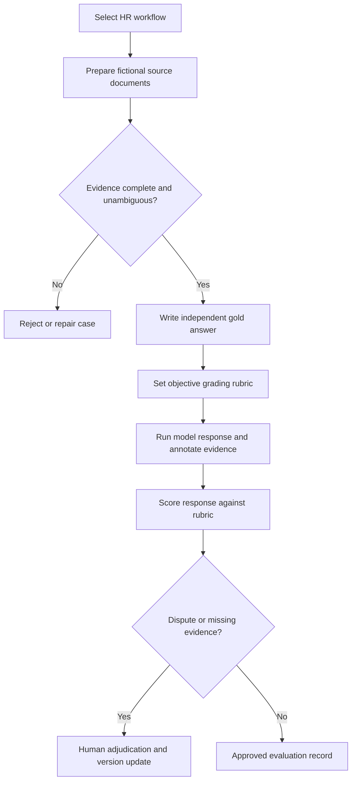

# 01 | HR Workflow Benchmark Design — how the assessment is built

## Plain-English meaning
A benchmark is a difficult but answerable work task given to an AI system so a human can check whether its answer is correct. A workflow benchmark goes beyond trivia: it makes the system **read several documents, apply the correct rules, do calculations, justify its evidence and admit uncertainty**.

## Step-by-step process

1. **Choose the real HR decision to simulate**: for example a final-payroll input check after an employee exit. Define its boundary. Here it excludes statutory entitlement computation.
2. **Collect realistic but fictional evidence**: one governing policy, signed agreement, draft transaction, HR approval and exception register. Use separate sources so the model must reconcile them.
3. **Set an answerable question**: "What is the determinable September gross payroll input under the written policy? What requires human review?"
4. **Validate the case is fair and complete**: dates and policy rules must be unambiguous. There must be an evidence-backed answer without assuming outside laws.
5. **Create a gold answer independently**: calculate AED 18,000 × 20/30 = AED 12,000; identify AED 6,000 excess draft base; flag AED 1,500 allowance still pending.
6. **Define an objective grading rubric**: allocate 10 points to the six observable criteria in the original work sample.
7. **Design distractors and negative cases**: a model may copy the draft instead of policy, include a pending allowance, fail to cite a document or invent statutory entitlements.
8. **Trial answers and calibrate reviewers**: compare the scoring rubric across candidate answers; adjudicate disagreements. Free-form answers must first be human-annotated.
9. **Reject/repair ambiguous cases**: missing policy, conflicting signed/approved dates without a tie-breaker, or questions requiring unseen legal interpretation are not gradeable.
10. **Keep a transparent audit trail**: task version, source set, author, approvals, gold answer, scoring criteria, reviewer changes and reasons.

## Workflow diagram

## What an employer can verify in this repository
A fully specified benchmark case, written documentary evidence A-E, a 10-point rubric, a machine-readable answer, a deterministic structured evaluator, examples and unit tests. No fabricated production usage or employer results.

## Cases for a future task library
- **Payroll & employee exits**: approved vs draft inputs, conflicting dates, allowance authorisation.
- **Workforce planning**: headcount plan vs approved requisitions, backfills and approval dates.
- **HR policy interpretation**: eligibility decisions using a defined policy and dated documentary evidence.
- **Employee lifecycle**: onboarding documents, expiry/renewal tasks and missing manager approvals.

These extra use cases are potential extensions, **not represented as completed benchmark cases here**.
