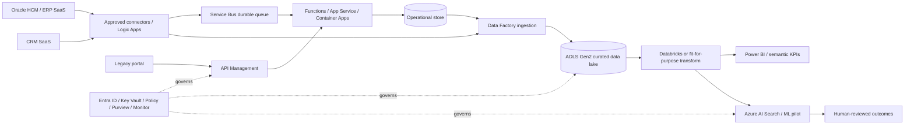

# 02 — Azure + Oracle enterprise reference architecture

**Reference-only**; no actual Azure subscription or Oracle tenant configured.

## Pattern selection
| Requirement | Pattern | Azure example | Main safeguard |
|---|---|---|---|
| Approved synchronous data query | REST | API Management + App Service | OAuth scopes, rate limits, provenance |
| Multi-step SaaS task | Workflow orchestration | Logic Apps | Idempotency and rollback/compensation |
| Durable asynchronous command | Queue | Service Bus | DLQ, retries and ordering policy |
| Event notification | Pub/sub | Event Grid | Consumer isolation and replay design |
| Scheduled governed analytics | Batch / incremental ETL | Data Factory + ADLS | CDC suitability, lineage and data minimization |
| Scalable app workload | Managed container | Azure Container Apps | Image scanning, secrets and monitoring |
| Complex cluster-specific needs | Kubernetes | AKS (conditional) | SRE maturity, policy and cluster ownership |

## Oracle/CRM considerations
Prefer vendor-supported APIs/connectors and signed integration contracts. No direct database write to Oracle SaaS. Perform master data ownership review, record-level access, GDPR/UAE privacy analysis as applicable, SAP/CRM compatibility due diligence, throttling and licensing review.

## TOGAF-style perspectives
**Business architecture:** capability mapping, business outcomes, KPIs and ownership. **Application architecture:** systems of record, event boundaries, API contracts, dependencies. **Data architecture:** lineage, classification, quality rules and retention. **Technology architecture:** landing zone, secure network, identity, resilience, observability and cost model.

## Nonfunctional acceptance (values to finalize with customer)
Security gates, traceability, reliable retry and tested dead-letter path; p95 latency and availability *targets TBD* after source-system sizing. All production release criteria require named accountable sign-off. No automatic claims of cloud compliance.
