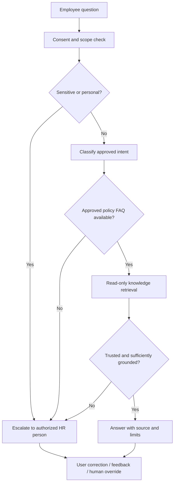

# 02 — Agent roles, tool contracts, human supervision

## Roles
- **Intake agent/step:** classify question, do not store sensitive free text without approval.
- **Knowledge retrieval:** read only from versioned policy store; permissions and stale-source rules.
- **Answer composer:** only approved excerpts, never makes contractual/legal promise.
- **Escalation coordinator:** creates draft handoff request subject to approved tool permissions.
- **Human reviewer:** employment/pay/disciplinary decisions remain accountable human actions.

## Tool contracts (proposed, not live)
`get_public_policy(topic, version)` returns approved published text and last-reviewed date; read-only.
`create_hr_handoff(category, summary)` returns a *proposed* ticket, only after consent and authorized user context. No open case creation in this demo.
`get_employee_payroll()` prohibited by default; require system/identity/role checks outside the agent if ever contemplated.

## Context and failure handling
System rules > validated signed knowledge > user question; retrieved documents are untrusted for instructions. Flag prompt injection, PII and requests for secrets. Missing knowledge -> abstain. Retrieval timeout -> human fallback. Duplicate action -> idempotency key and no mutation. Audit = tool inputs, output reference/version, permission decision and reviewer.

## Prototype vs. full product
`src/product_agent.py` is a tiny offline rule-based stand-in to exercise routing, tool permissions and handoffs. It does NOT make remote API calls or generate LLM text. Production delivery would require user interviews, tested retrieval, privacy reviews, specialist engineering, and approved rollout.
