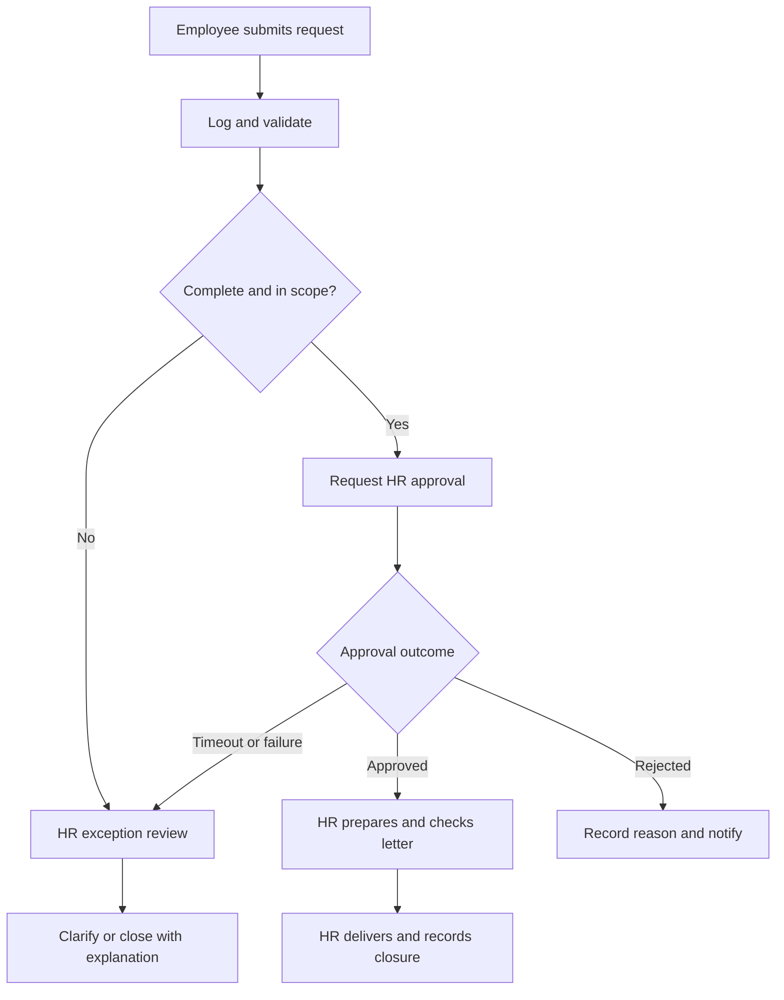

# Case study — From email chasing to a tracked HR request

## Scope and context
**Case type:** fictional service redesign. **Process owner:** HR Operations. **Service:** a standard employment-confirmation letter that excludes salary, banking and immigration details. The fictional organisation has 250 employees and handles an assumed 100 requests monthly. These figures are scenario assumptions, not market statistics.

The project covers submission, validation, HR approval, manual letter preparation, delivery and closure. Payroll changes, employment decisions, legal advice and automated document generation are outside the first release.

## AS-IS: where work gets delayed
1. An employee sends an email with inconsistent information.
2. HR asks follow-up questions and manually records the request.
3. HR forwards it for approval and searches email for the response.
4. An HR officer prepares and checks the letter.
5. HR sends it, updates the spreadsheet and answers status enquiries.

| Friction | Likely consequence in this scenario | Redesign decision |
|---|---|---|
| Incomplete intake | Follow-up messages | Required structured fields |
| Approval buried in email | Uncertain status | Recorded approval reference and outcome |
| Repeated status enquiries | More handling effort | Acknowledgement and milestone notifications |
| No visible owner | Requests can stall | Named HR owner and exception queue |
| Duplicate submissions | Repeated work | Unique intake reference and duplicate protection |

## TO-BE: proposed process
The diagram is a business process flow, not a BPMN 2.0 model or an actual Power Automate export.

## Ownership and decisions
- **Employee:** submits accurate details and responds to clarification.
- **HR officer:** validates the request, confirms employee details in the authorised HR source, prepares and delivers the letter.
- **HR approver:** authorises release under the organisation's policy. Approval never means the letter has already been delivered.
- **Flow owner:** resolves connection failures, checks run history and controls changes.
- **HR Operations lead:** owns service performance and approves pilot expansion.

The requester cannot select their own approver. Routing uses an HR-controlled approver record. Requests outside the standard service go to human review.

## Practical AI adoption
Copilot in Power Automate is proposed as a development assistant: help describe the flow, suggest a structure and explain conditions. The HR process owner reviews the resulting design against actual policy. Only fictional examples should be used during learning.

This is a deliberately limited AI use case. Runtime routing, approvals and closure follow defined conditions. Drafting an employee-facing letter with generative AI would be a separate future proposal requiring approved source material, privacy review and human verification.

## Deliverables and results
**Created:** process analysis, proposed workflow architecture, ownership model, acceptance scenarios, adoption plan and illustrative value model.

**Expected benefits to test:** fewer manual handoffs, clearer ownership and faster status visibility. A model in the validation document estimates 13.3 gross staff hours released per month under its assumptions. This is a planning estimate, not an achieved saving.

**Evidence still needed:** configured flow, successful and failed run examples, signed UAT, actual handling-time observations and pilot feedback.

© 2026 Bircan Uzan — All Rights Reserved.
