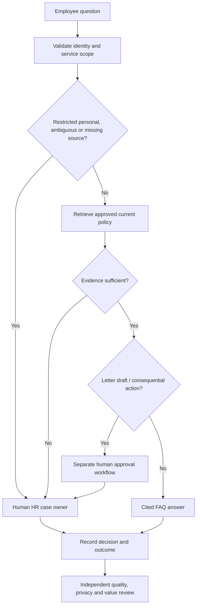

# Case study — HR Service Agent operating model for UAE professional-services organisations

## Business challenge
A professional-services HR operations team receives recurring policy, onboarding and employment-letter enquiries. Repeated triage creates unnecessary manual work, while personal requests, confidential data and changing policies make unfenced AI automation risky. This is an **original UAE sector-based demonstration**, not a representation of work carried out for a specific employer or paying client.

## The question
How should an organisation define a digital worker's responsibilities, assessment criteria, boundaries, probation, human-manager accountability and retirement decisions — and what can we actually test before enterprise implementation?

## Scope and baseline
- **In:** general working-hours, annual-leave process, new-joiner process, hybrid working, office-information questions from **invented sample policies**; non-actionable letter-draft request.
- **Out:** actual employment decisions, eligibility/entitlement, payroll, personal employee records, UAE legal advice, visa decisions, HRIS write access, letter dispatch.
- **Baseline:** business process analysis based on a typical HR shared inbox, not measured operations. No fabricated organisation size, volume, ROI, cost or customer engagement.

## Operating-model design

## Hands-on evidence now linked
A local browser-accessible JavaScript assistant and its 28-case executed evaluation are in [Project 43](../43_Microsoft_Copilot_Studio_HR_Service_Agent_Prototype/). For the direct interview question **“Which AI agent did you actually test, what did it respond, and how did you capture the evidence?”**, see the exact answer and citations in this project's [README](README.md) and the [verbatim dated JSON trace](../43_Microsoft_Copilot_Studio_HR_Service_Agent_Prototype/evidence/2026-10-29_test_run.json). The local prototype is deterministic and **not** a live LLM/Copilot Studio agent.

Actual observed: 26/28 expected decision+source matches (92.9%). Two missed phrases resulted in conservative human escalation. No HR data accessed, no third-party connectors invoked, and **no real approvals were routed**. The evidence is suitable for a technical learning demonstration, not a deployment or security-assurance claim.

## Human–AI design contribution
Competency mapping; human-vs-automation-vs-agent task decomposition; an assessment rubric; model and policy-change retesting plan; probation gate; reviewer accountabilities; stakeholder change and operational KPI ownership. Technical access, policy correctness and acceptance need independent HR, engineering and InfoSec validation before real-world use.
