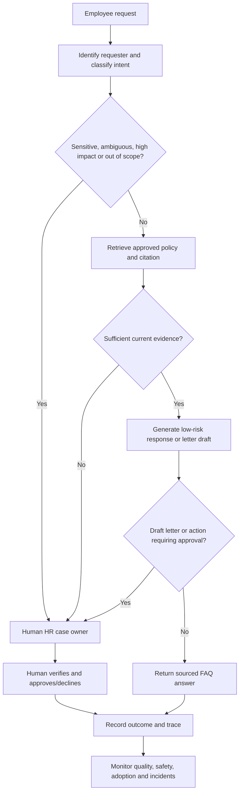

# Case study — Introducing an HR Operations AI Agent as a supervised digital worker

## Background
**Organisation:** Fictional, UAE-based, 800-employee professional-services group.  
**Agent:** "HR Service Agent", a proposed Microsoft 365-integrated employee-service assistant.  
**Purpose:** Respond to non-sensitive FAQ questions using an approved, versioned policy library; prepare draft standard employment-letter requests for human checking.  
**Not in scope:** Hiring/selection decisions, employee scoring, disciplinary actions, salary changes, payroll writeback, medical/identity document collection, UAE legal interpretations, visa decisions or autonomous letter issuance.

## Baseline: AS-IS (fictional process)
1. Employee emails a shared HR inbox.
2. HR coordinator identifies request type and checks policy.
3. HR clarifies missing details, manually drafts answer/letter, obtains manager approval and replies.
4. HR manually records closure; exceptions are difficult to analyse.

**Problems to investigate:** duplicated triage, variable policy accuracy, inconsistent audit records, privacy risk, limited visibility into bottlenecks. No measured time/cost baseline is asserted.

## TO-BE: supervised work allocation

**Key distinction:** An agent may prepare work, but a human retains authority for regulated or consequential HR actions. Workflow automation handles approvals; the model does not grant itself permission.

## Job description for the digital worker
- **Role title:** HR Service Agent (limited-scope knowledge assistant).
- **Accountable human owner:** HR Operations Manager.
- **Skills:** Intent recognition, retrieval grounded in current policy, correct refusal/escalation, concise communication, traceable citation, privacy-aware handling.
- **Permissions:** Read-only access to explicitly approved FAQ content; ability to draft, not send, employee letter requests; no write access to HRIS or payroll.
- **Performance conditions:** Correct policy references, full audit trail, strict escalation thresholds, no unauthorised action.
- **Probation:** A gated, supervised trial with synthetic and pre-approved test data before any real employee interaction.

## Human–AI task decomposition
| Work activity | AI agent | Human | Control |
|---|---|---|---|
| Answer general leave policy FAQs | Draft sourced answer | Review samples and complaints | Versioned policy content; no invented entitlements |
| Identify request category | Suggest label | Handle uncertain classifications | Confidence/evidence gate |
| Prepare employment-letter request | Draft only | Validate data and approve | Approval in Power Automate/Teams (proposed) |
| Update salary, visa, payroll or employment status | No | Own decision and system entry | No write tool permissions |
| Investigate incident, red-team result or appeal | Log, flag and route | Investigate, decide, remediate | Incident playbook and kill switch |

## Distinctive HR contribution
Reuses **competency frameworks** (what good performance looks like), **assessment-centre rubric** (scenario evidence), **probation** (limited trial), **performance review** (quality and safety metrics), **RACI** (accountability), and **change management** (human adoption).

## Assumptions and limitations
All company characteristics and test records are invented. No agent was connected to SharePoint, Copilot Studio, HRIS, Power Automate or employee data; no AI-generated responses were tested. This is a portfolio-ready governance concept plus synthetic scoring demonstration, not a completed production implementation.
