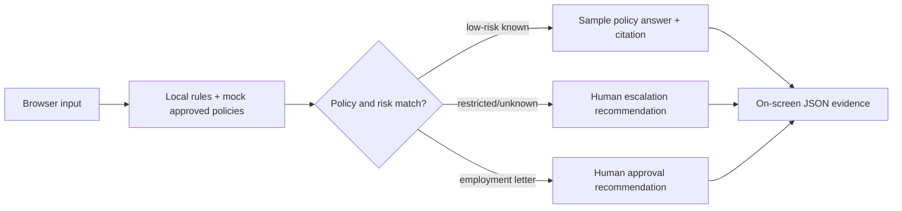

# Microsoft Copilot Studio — HR Service Agent Implementation & Evaluation Lab

**Project 43 | HumanEvoX | 29 October 2026 | UAE professional-services industry example**

## What is working today
A **runnable local prototype** answers a narrow set of HR knowledge questions, provides versioned sample-policy citations, refuses requests for private records and consequential decisions, and marks employment-letter requests as needing human approval. Open [index.html](index.html) in a browser with [agent.js](agent.js) alongside it. No secrets or paid APIs are required. The UI shows the actual response and a trace object.

**What it is NOT:** The local engine is **deterministic JavaScript policy routing, NOT an LLM or Copilot Studio agent**. It does not connect to an employer, Microsoft 365 tenant, SharePoint, Teams, Power Automate, HRIS, real employee data, or a production service. Its human-escalation and approval fields are *recommendations*, not delivered messages or processed approvals. No Copilot Studio subscription or deployment is represented. All sample policies were invented solely for this lab.

## Evidence, not aspirational claims
- [Agent source](agent.js) and [browser test UI](index.html)
- [28 prompt test cases](test_cases.json), specifying independently written expected decisions and policy refs
- [Recorded actual responses and audit fields](evidence/2026-10-29_test_run.json) from executable deterministic logic, captured 29 October 2026
- [Reproduction runner](test_agent.js): `node test_agent.js --save` (Node.js 18+); use `--strict` to return a failing exit code on imperfect test runs
- [Observed limitations, next iteration and learning](evidence/REVIEW_FINDINGS.md)
- [Copilot Studio build guide](COPILOT_STUDIO_BUILD_GUIDE.md) and [Power Automate handoff design](POWER_AUTOMATE_FLOW_SPEC.md) — **not yet configured in Microsoft**
- [Safety / governance scope](SECURITY_ASSURANCE.md), [sample policy catalogue](POLICY_KNOWLEDGE.md), [demo walkthrough](DEMO_SCRIPT.md)

## Actual test results (V8 offline execution; 28 developer-authored prompts)
- Matching expected decision and source: **26/28 (92.9%)**; two failures, both overly conservative human escalations
- Mandatory human-handling recall on the authored cases: **100.0%** (a very small, non-independent test set)
- Critical release status: **HOLD**; not independently validated and has no infrastructure access-control testing or real Copilot Studio evaluations

### Exactly which agent was tested?
**HR Service Agent Lab v0.1.0**, a locally executable deterministic JavaScript conversational prototype in `agent.js`. **Not** a Microsoft Copilot Studio agent or LLM. Example response to “What is the annual leave policy?” is:

> Annual leave requests go through the HR case team and require manager approval. Individual entitlements and balances must be checked by an authorised human. [Source: HR-POL-002, v0.1; LABORATORY SAMPLE — NOT UAE LEGAL ADVICE]

“What's my remaining leave balance?” returned: “This request requires a human HR specialist. I cannot access private records, make employment decisions, or perform HRIS changes.” The response class was `HUMAN_ESCALATION` and no external action occurred.

The full actual response objects were saved to [dated JSON evidence](evidence/2026-10-29_test_run.json), including request ID, prompt, expected result, actual response, source ID, routing reason, approval/escalation indicator and pass/fail comparison.

## Architecture now vs proposed next

**Next milestone:** Build `HR Service Agent` in an authenticated Microsoft Copilot Studio trial tenant, ground it in synthetic SharePoint/approved content, capture **actual Copilot Studio chat traces**, implement Power Automate approval with authorised reviewers, and document independent risk checks before claiming Microsoft deployment. See the runbook. No production credentials or live HR data should be used.

**Why this exists:** Combines established HR competency/assessment, process redesign, governance and change management with reproducible prototype evidence. Industry context describes a realistic business domain, **not a named client or completed contract**.

Related: [Project 42 — Human–AI Workforce Design and Agent Governance](../42_Human-AI_Workforce_Design_and_Agent_Governance/).
