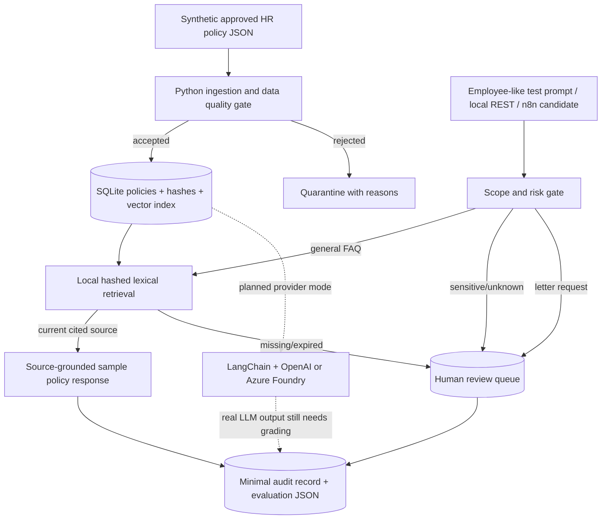

# Architecture and end-to-end data flow

## Data contract and transformations
1. **Bronze (input):** `data/policies.json` is an invented policy feed. Keys include `policy_id`, `title`, `body`, `keywords`, `owner`, `version`, approval and validity window.
2. **Silver (curated):** `ingestion.py` rejects missing keys, expired/unapproved policies and short content. SHA-256 fingerprint tracks the exact source record. A local SQLite UPSERT is idempotent for identical input. Quarantine is returned in the ETL report; this is not yet persistent enterprise DLQ storage.
3. **Index:** `retrieval.py` derives a SHA-256-stable 256-dimensional **lexical hash vector**, saves JSON to `vectors` table with a `model` label and performs cosine ranking within the approved policy class. The threshold is educational and not empirically calibrated; it is not an embedding model.
4. **Gold (service outcome):** `Agent.ask` checks scope/risks before retrieving. It either returns a verifiable **sample-policy** citation or creates a local queue item with **no** external message/HRIS action.
5. **Evaluation:** `run_lab.py eval` executes actual code on a versioned test set and captures decisions, returned text, source identifiers/hashes, errors, limitations and metric computation. It is author-created evaluation, not independently adjudicated.

## SQL entities
- `policies`: curated, time-bounded approval and fingerprint.
- `vectors`: `(policy_id, model)` keyed vectors. Model labels prevent accidental mixing of neural and lexical vectors.
- `policy_links`: local knowledge graph with explicit relation labels.
- `review_queue`: ticket-only, minimal metadata; no personal request text stored.
- `audit_events`: event ID, outcome, reason, source IDs, action type; no raw employee prompt stored in the SQL audit table.

## Performance and design limitations
- SQLite plus Python loops are appropriate for a small lab, **not a claim of scalable production search**.
- Lexical hash vectors may collide, confuse synonyms and mis-rank documents. Category routing uses patterns, not a trained classifier.
- SQL `date('now')` and local ingestion date should use a common timezone in a deployment; this demo uses local date for ingest and SQLite UTC date for retrieval.
- Event IDs are random UUIDs; timestamps and evidence manifests allow reconstructing test runs, but there is no independent signed attestation.
- The HTTP service binds to loopback only and lacks production authentication for `/ask`. Do not expose or use with sensitive data.
- Two human sign-off stages must exist in a real organisation: domain HR policy owner and independent security/AI engineering reviewer.

## Scaling pattern — proposals, not accomplishments
Azure Storage/ADLS Gen2 or Fabric Lakehouse → Databricks Spark ingestion/Delta quality → Azure SQL / Fabric Warehouse for structured metadata → Azure AI Search vector/hybrid index with approved semantic embeddings → managed Foundry agent orchestration with per-user RBAC → API Management + managed identity → n8n/Power Automate approval service → Azure Monitor/App Insights tracing with privacy controls → GitHub Actions/AKS/Container Apps CI/CD. Perform load, failure and permission tests before production.
