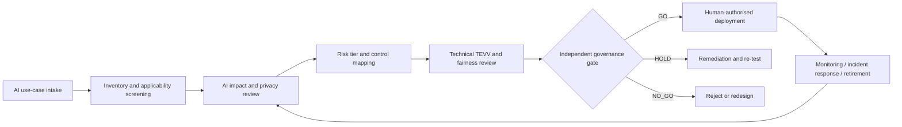

# AI Ethics, Responsible AI & AI Governance
### Project 44 | Enterprise Responsible AI Governance Office — UAE synthetic demonstration
**Portfolio status:** Independent, employer-neutral design and deterministic local prototype. Updated 29 October 2026.

## Executive case
A **fictional UAE diversified enterprise** is adopting GenAI, agentic AI and predictive AI in recruitment, claims triage, employee services and general productivity. Executive leadership needs a consistent answer to **which AI systems may be used, by whom, under what conditions, with what evidence, and when a human must intervene**. The project builds a practical governance operating model, rather than merely discussing ethical principles.

The design consolidates four UAE vacancy descriptions: Capgemini Invent (Responsible AI & AI Governance); Al-Futtaim/Orient (AI, Data Governance & Privacy Officer); byteSpark.ai client vacancy (Head of AI Ethics & Responsible AI); and Q-REF (AI Governance Specialist / AI Ethics Specialist). The RTA Manager - AI Solutions Quality Assurance description is included as a **fifth supplemental QA lens** because it was also displayed in the earlier shortlist. Requirements are summarized, not presented as qualifications already possessed.

## What is built
1. **Governance office and decision rights:** charter, 3-lines-of-defence-style RACI, committee, AI lifecycle stage gates and escalation paths.
2. **Inventory and impact assessment:** 4 fictional AI systems, use-case intake, internal tiering, social impact, autonomy and human oversight.
3. **Risk and control framework:** 14 risks across fairness, explainability, model error, injection, privacy, unauthorized agent actions, supplier risk, drift and shutdown; mapped owners and evidence.
4. **AI assurance:** test protocols, fairness review design, safety and UAT gates, independent review, model card, monitoring and retirement.
5. **Privacy and data governance:** PDPL/DIFC/GDPR applicability screening, DPIA template, data lineage/stewardship and vendor due diligence.
6. **Agentic control plane:** permission boundaries, identity, tool allowlists, prompt governance, transaction limits, immutable event log and human approvals.
7. **Executable governance-gate demonstrator:** standard-library Python reads synthetic JSON approvals, returns GO/HOLD/NO_GO decisions, exports transparent reasoning and runs unit tests. It is **a deterministic policy checker, not an LLM, model audit, live AI service or regulatory compliance certification**.
8. **Synthetic fairness audit:** execute Python on 20 fictional candidate labels to calculate group selection rates and true-positive rates; deliberately contrast outcomes and document limits. No real model was trained or tested.
9. **Executive board pack and capability development roadmap:** operating KPIs, incidents, residual risks, maturity and role readiness.
10. **Regulatory, sovereign AI and AI Factory annex:** jurisdictional screening and enterprise intake control mapping.

## Project files
| File | What it proves |
|---|---|
| [01_JD_SKILLS_MATRIX.md](01_JD_SKILLS_MATRIX.md) | Four-role requirement analysis plus supplemental RTA quality controls |
| [02_GOVERNANCE_CHARTER.md](02_GOVERNANCE_CHARTER.md) | Policy, ownership, decision rights, committees and lifecycle |
| [03_AI_SYSTEM_INVENTORY.csv](03_AI_SYSTEM_INVENTORY.csv) | Risk-tiered model / AI use-case register |
| [04_AI_IMPACT_ASSESSMENT.md](04_AI_IMPACT_ASSESSMENT.md) | Completed sample AI impact review and conditional decision |
| [05_RISK_REGISTER.csv](05_RISK_REGISTER.csv) | Controls, risk treatment, owners and evidence requirements |
| [06_CONTROL_LIBRARY.csv](06_CONTROL_LIBRARY.csv) | Practical control catalogue with mapped frameworks |
| [07_PRIVACY_DPIA_AND_DATA_GOVERNANCE.md](07_PRIVACY_DPIA_AND_DATA_GOVERNANCE.md) | DPIA, data governance and jurisdiction checks |
| [08_AGENTIC_CONTROL_PLANE.md](08_AGENTIC_CONTROL_PLANE.md) | Agent autonomy, tool, approval and incident boundaries |
| [09_TEVV_FAIRNESS_MODEL_ASSURANCE.md](09_TEVV_FAIRNESS_MODEL_ASSURANCE.md) | Validation, fairness, red-team and monitoring test plan |
| [10_MODEL_CARD_AND_VENDOR_ASSESSMENT.md](10_MODEL_CARD_AND_VENDOR_ASSESSMENT.md) | Model/system documentation and vendor review |
| [11_AUDIT_EVIDENCE_AND_MONITORING.md](11_AUDIT_EVIDENCE_AND_MONITORING.md) | Evidence manifest, retention, KPIs and incident response |
| [12_EXECUTIVE_BOARD_PACK.md](12_EXECUTIVE_BOARD_PACK.md) | Sample C-suite governance decision briefing |
| [13_SKILLS_AND_TOOLS_ROADMAP.md](13_SKILLS_AND_TOOLS_ROADMAP.md) | Role-by-role capability and upskilling |
| [governance_gate.py](governance_gate.py) | Executable local policy-decision demonstrator |
| [synthetic_gate_cases.json](synthetic_gate_cases.json) | Fully fictional case inputs; not real audit evidence |
| [test_governance_gate.py](test_governance_gate.py) | Reproducible unit tests |
| [SOURCES_AND_LIMITATIONS.md](SOURCES_AND_LIMITATIONS.md) | Job descriptions, official reference links and limitations |
| [14_FAIRNESS_LAB.md](14_FAIRNESS_LAB.md) | Executable calculations on invented candidate outcome labels |
| [15_REGULATORY_SOVEREIGN_AI_AND_FACTORY.md](15_REGULATORY_SOVEREIGN_AI_AND_FACTORY.md) | EU/UAE applicability, sovereign AI and AI Factory overview |
| [RUN_AND_TEST_GUIDE.md](RUN_AND_TEST_GUIDE.md) | Commands and expected synthetic control-gate outcomes |
| [fairness_audit.py](fairness_audit.py) and [test_fairness_audit.py](test_fairness_audit.py) | Reproducible synthetic fairness metrics and unit tests |
| [synthetic_fairness_cases.csv](synthetic_fairness_cases.csv) | Artificial subgroup and selection outcomes |

## End-to-end decision flow


## Reference frameworks (alignment, not certification)
- NIST AI RMF 1.0: **GOVERN, MAP, MEASURE, MANAGE**; NIST GenAI Profile 600-1.
- ISO/IEC 42001:2023: AIMS leadership, risk, controls and continual improvement.
- ISO/IEC 23894:2023: AI-specific risk management guidance.
- ISO/IEC 27001, OECD AI Principles and EU AI Act: reference inputs where applicable, **not blanket UAE legal duties**.
- UAE Federal PDPL and potentially DIFC/ADGM privacy regimes depending on entity and processing scope; counsel reviews applicability.

## Run the local control gate
```bash
python governance_gate.py synthetic_gate_cases.json
python -m unittest test_governance_gate.py -v
python fairness_audit.py synthetic_fairness_cases.csv
python -m unittest test_fairness_audit.py -v
```
No external dependencies or API keys. The gate evaluates **self-declared synthetic control statuses** only: an actual assurance decision also requires verified artifacts, independent model testing, accountable sign-off and legal counsel.

## Integrity statement
All organisations, system inventories, people, ratings, evidence-status flags, decisions and KPIs in this case are invented for learning. No actual claims of deployment, technical ML model validation, formal ISO conformance, legal certification, regulator engagement, or paid client experience. Prior projects 37 and 42 address HR-specific risk assessment and human–AI workforce design; **Project 44 expands into a cross-functional enterprise governance operating model and cross-role JD matrix**.
