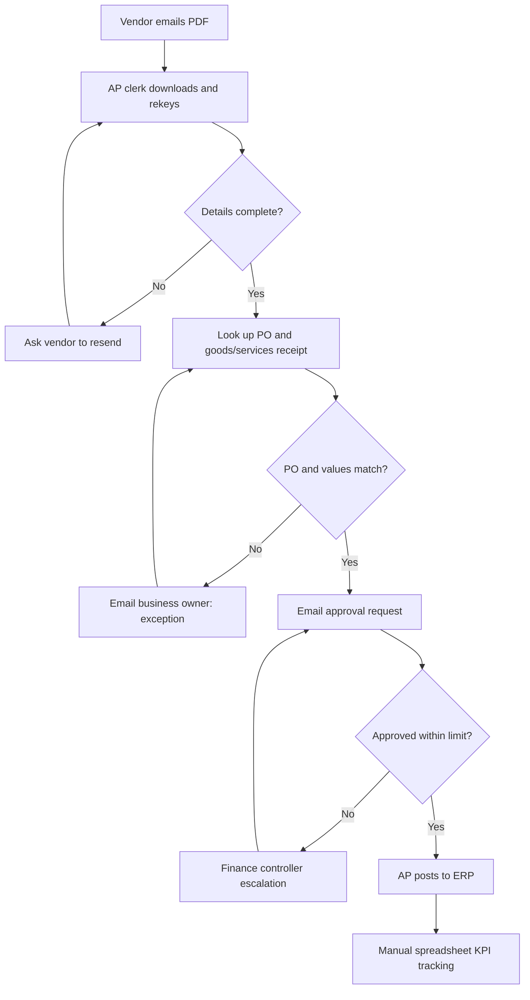

# A1 — Process Analysis: Discovery Plan, SIPOC and AS-IS

## Fictional operating context and initial hypothesis
Entity mix: property development, construction projects, facilities/property management and group shared services. Proposed scope: supplier invoice intake from vendors to accounts payable (AP) review and approval; exclude payment authorization. **All baseline numbers are assumptions awaiting validation.**

## Discovery workshop plan
| Session | Attendees | Prompts | Evidence to request | Decision/output |
|---|---|---|---|---|
| 1. Executive framing (45m) | Director of AI, CFO delegate, Procurement head | Which outcomes matter? Who funds? Regulatory boundaries? | mandate, KPI definitions, policies | sponsor, scope, risk appetite |
| 2. Process walk-through (90m) | AP processors, procurement, site ops, IT BA | Show 10 examples including 3 exceptions; where do rekeying and chasers occur? | redacted invoice examples, timestamps, queue logs | AS-IS map, variability |
| 3. Control design (60m) | Finance controller, audit, cybersecurity, data privacy | Duplicate checks? maker/checker? supplier-bank amendments? | approval matrix, retention rules, ERP access roles | control baseline and hard stops |
| 4. Technology & feasibility (60m) | ERP owner, integration, automation architect | APIs? shared inbox? document formats? tenant/licences? | sandbox and schema access, error logs | feasibility rating and NFRs |
| 5. User/change validation (60m) | AP supervisors, L&D, HR, AI champions | Which tasks frustrate users? What would build trust? | role analysis, user interviews | future-state design and adoption risks |
| 6. Benefits baseline (45m) | FP&A, operational analyst | Actual volume, touch time, rework, SLA, loaded cost? | 8–12 week sample with entity splits | measurement protocol and sign-off |

### Discovery facilitation rules
- Ask participants to *show actual process evidence* rather than rely on recollection; redact supplier names, banking identifiers and personal details.
- Sample invoice types: PO matched, no PO, duplicates, overseas VAT variation, incomplete submission, disputed services, change of banking details.
- Capture per step: owner, system, input, decision rule, cycle time, touch time, wait time, defect, control, audit record, proposed improvement.
- Do not promise full automation before ERP/vendor security, data-protection and approval requirements are verified.

## SIPOC
| Suppliers | Inputs | Process | Outputs | Customers |
|---|---|---|---|---|
| External vendors; project teams | invoice, PO, delivery evidence, approved vendor record | Receive → validate → code → match → resolve exception → request approval → post | classified invoice, exception ticket, approval audit, ERP posting request | AP, purchasing, project owners, treasury, vendors |

## AS-IS textual swimlanes (hypothetical)

## Issues for validation
1. Multiple entity inboxes and undocumented handoffs; no common case ID.
2. Repeated typing and attachment chasing; avoidable exception latency.
3. Approval steps in email with unreliable audit trails.
4. Lack of traceable PO mismatch vs duplicate vs bank-change exception treatment.
5. Reporting by anecdote rather than timestamped workflow stages.
6. Sensitive supplier financial information sent outside protected systems.

## Baseline measurement specification
| Metric | Definition | Baseline source and calculation |
|---|---|---|
| Invoices per month | eligible unique invoices received | mailbox intake + ERP reconciliation; dedupe |
| Touch time | active human minutes per invoice (not elapsed time) | time study of stratified sample; measure mean, median, p90 |
| End-to-end cycle time | received → posted (business hours and calendar separately) | timestamp join; p50/p90 |
| Exception rate | human-exception invoices / total | labelled case classes, double reviewed |
| First-pass valid | complete, matched and approved without return / total | workflow event log |
| SLA compliance | cases completed by category-specific SLA / due cases | entity/timezone-aware clock |

**Illustrative base assumptions only:** 2,400 invoices/month; 20 minutes current average touch time. These are **not** Azizi or UAE industry figures. Baselines must be approved by Finance and AP.

## Stakeholder RACI
| Deliverable | AI Lead | AP owner | ERP/IT | Risk & privacy | Finance sponsor |
|---|---|---|---|---|---|
| AS-IS map | R | A | C | C | I |
| Feasibility | R | C | A | C | I |
| Business case | R | C | C | C | A |
| Approval rules | R | A | C | C | C |
| Production change approval | R | A | R | C | A |
R=Responsible, A=Accountable, C=Consulted, I=Informed. Final sign-off assignment is proposed, not obtained.