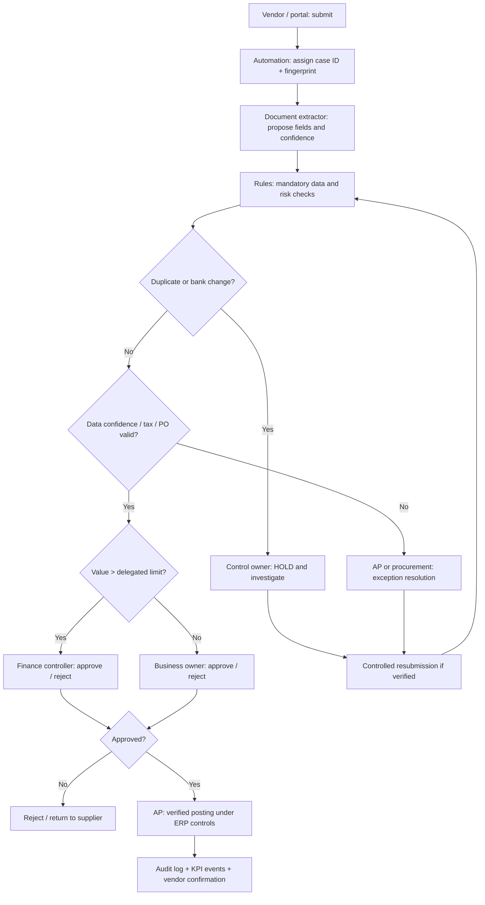

# B2 — TO-BE Process Redesign, Approval Controls and Accountability

## Process redesign principles
1. Standardise intake and entity context before AI; capture a unique case ID and policy version.
2. Separate **data extraction**, **deterministic controls**, **human judgement**, **ERP posting** and **payment authorisation**.
3. Use AI to propose field values and optionally draft vendor replies; no AI approval authority.
4. Every exception must have exactly one queue owner, SLA, escalation path and immutable record.
5. Do not make exception-free invoices “auto-paid”: the demonstration only routes to a named human approver.
6. Design for regional and entity-specific tax, currency and delegation rules; fictional threshold AED 25k is a placeholder.

## TO-BE swimlane map (conceptual; BPMN mapping documented below)

### BPMN 2.0 interpretation / modelling checklist
- **Pools:** External supplier (message flow); Enterprise shared-services process (sequence flows).
- **Lanes:** Intake automation; AP; Procurement; Finance Controller; Business Approver; ERP authorised posting.
- **Start event:** message/invoice received; **end events:** rejected/returned, posted for payment-cycle processing.
- **Tasks:** register; extract; validate; resolve; review; approve; post; report.
- **Exclusive gateways:** risk flag? field completeness? PO match? amount/authority? approved?
- **Boundary error/timer events to add in modeler:** OCR/API timeout, SLA breach and rework; retry only with idempotency keys.
- **Data objects:** invoice, PO match evidence, approval record, exception ticket.
- **Audit:** event ID, timestamp, actor or service identity, policy version, result; redact supplier PII and banking values.
This is a documented BPMN-oriented process specification, **not** a validated BPMN XML file.

## Control matrix
| Control | Trigger | Prevention/detection | Owner | Audit evidence | Automated demo? |
|---|---|---|---|---|---|
| C01 Missing/invalid invoice | required data absent | NEED_INFO route | AP | missing fields | Yes |
| C02 Duplicate | duplicate flag | HOLD_DUPLICATE | AP controls | fingerprint + vendor/invoice comparison | Yes (flag simulated) |
| C03 Banking change | bank-change flag | ESCALATE_BANK_CHANGE | vendor master | ticket + second-party verification | Yes (flag simulated) |
| C04 Tax check | invalid VAT flag | REVIEW_TAX | tax/AP | review notes | Yes (flag simulated) |
| C05 OCR uncertainty | confidence <0.90 | REVIEW_EXTRACTION | AP | field source+correction record | Yes (confidence simulated) |
| C06 PO missing | no PO | MANUAL_PO_EXCEPTION | procurement | no-PO authorization | Yes |
| C07 PO mismatch | PO not matched | REVIEW_PO_MISMATCH | procurement | PO / GRN reconciliation | Yes (flag simulated) |
| C08 High-value authority | amount >25000 | FINANCE_APPROVAL | controller | delegated approval | Yes (route only) |
| C09 Standard authority | matched <=25000 | BUSINESS_OWNER_APPROVAL | budget owner | human approval | Yes (route only) |
| C10 Segregation of duties | author equals approver | prevent posting | Finance IT | RBAC log | **Design only** |
| C11 Service outage | extraction/orchestration unavailable | fail closed; manual queue | IT operations | alert + incident ticket | **Design only** |
| C12 Audit completeness | missing event | STOP release | risk/audit | end-to-end trace | **Design only** |

## Segregation and escalation boundaries
- **AP clerk:** correct intake fields; cannot approve own claim or change vendor bank account.
- **Budget owner:** validate delivery and approve within approved delegation.
- **Controller:** approve exception/high-value transactions within delegated authority; no autonomous override.
- **Vendor master-data team:** independently confirms bank changes using verified out-of-band channel.
- **IT support:** repair service only; cannot approve invoices.
- **Director of AI:** portfolio prioritization and performance review; not an invoice approver.
- **AI Lead:** requirements, design, UAT coordination, adoption and KPI governance; **does not approve payments**.

## Proposed stack architecture / operational controls
Power Automate orchestrates SharePoint/Dataverse structured records and Teams approvals; AI Builder may supply candidate invoice fields; ERP read-only lookups verify PO and master data. Actual connectors, licensing and environment boundaries must be validated. For high risk data use restricted environments, DLP, managed identities, document retention and data-processing review. Power BI displays role-filtered aggregates.

## Exception ownership / SLA proposal
| Queue | First owner | Response target (proposed) | Escalate to |
|---|---|---|---|
| NEED_INFO | AP | 1 business day | AP manager |
| HOLD_DUPLICATE | Fraud/control reviewer | 4 business hours | Financial controller |
| ESCALATE_BANK_CHANGE | Vendor master-data + fraud | stop pending independent verification | Controller + Security |
| REVIEW_EXTRACTION | AP quality reviewer | 1 business day | AP manager |
| REVIEW_PO_MISMATCH | Procurement/business owner | 2 business days | Procurement head |
| FINANCE_APPROVAL | Controller | 1 business day | CFO delegate |

Targets are unapproved suggestions, not contractual SLAs.