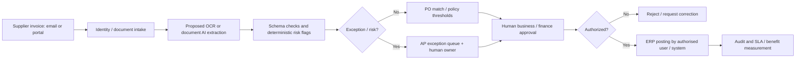

# AI Lead — Systems, Process & Enterprise Automation
### Project 45 | UAE multi-entity property development group | end-to-end portfolio demonstrator

**Author:** Bircan Uzan · HumanEvoX · 29 October 2026  
**Project type:** Independent, **fictional** and employer-neutral business transformation case inspired by the [Azizi Developments AI Lead Systems and Process vacancy](https://www.linkedin.com/jobs/view/4477076564/). **Not** an Azizi project, employment record, customer implementation, or live enterprise deployment.

## Executive problem statement
A fictional UAE group with construction, property management and corporate shared-services entities has fragmented workflows and a long queue of AI proposals. Procurement and finance still manually triage supplier invoices, leading to rekeying, duplicate-review risk, slow approvals and poor visibility. The AI Lead must select high-value opportunities, redesign the end-to-end workflow, gain governance sign-off, coordinate adoption and show defensible benefits.

**Integrated case:** select and design a controlled *Supplier Invoice Intake & Exception Routing* solution. Assess five other cross-group opportunities in the wider AI portfolio. A **deterministic local JavaScript demonstrator** exercises the routing rules on made-up invoice records. It **does not** perform OCR, LLM inference, SAP/Oracle/ERP writes, payments or actual Power Automate orchestration.

## Navigation — role responsibilities A–D
| Responsibility | Evidence deliverable |
|---|---|
| **A · Process Analysis & Opportunity Discovery** | [01 — Workshops and AS-IS discovery](01_DISCOVERY_WORKSHOPS_AS_IS.md), [02 — cross-group opportunity pipeline](02_AI_USE_CASE_PIPELINE.csv), [03 — business case and investment options](03_BUSINESS_CASE_AND_PRIORITISATION.md) |
| **B · Requirements & Process Design** | [04 — BRD, functional specs, user stories](04_BRD_FSD_USER_STORIES.md), [05 — TO-BE workflow and controls](05_TO_BE_PROCESS_AND_CONTROLS.md), [06 — UAT scenarios and sign-off](06_UAT_AND_BUSINESS_SIGNOFF.md), [routing_demo.js](routing_demo.js) and [synthetic_invoices.json](synthetic_invoices.json) |
| **C · Adoption & Change** | [07 — change, champions, communications, SOP and training](07_CHANGE_CHAMPIONS_SOP_AND_TRAINING.md) |
| **D · Benefits & Performance** | [08 — adoption KPI scorecard and measurement](08_KPI_BENEFITS_AND_PERFORMANCE.md), [09 — Director of AI steering brief](09_EXECUTIVE_STEERING_BRIEF.md), [demonstration_evidence.json](demonstration_evidence.json) |
| **Reproducibility and honesty** | [test_routing_demo.js](test_routing_demo.js), [10 — sources and evidence limits](10_SOURCES_RUN_GUIDE_AND_LIMITATIONS.md) |

## Architecture and decision boundaries

**Non-negotiable:** An AI extraction output is a *suggestion*, not authority. Bank changes, suspected duplicates, missing PO, poor confidence and approval-limit breaches are sent to humans. No automated bank-data changes or payments.

## Proposed stack (not claimed implemented)
**Methods:** discovery interviews, SIPOC, BPMN 2.0-oriented maps, VSM, weighted prioritization, BRD/FSD, Agile user stories, MoSCoW, acceptance criteria, UAT, Prosci-inspired ADKAR, RACI, benefits realization, PDCA.  
**Solution candidates:** Microsoft Power Automate + AI Builder (document processing) + SharePoint/Dataverse + Teams approvals + Power BI; alternatively UiPath Document Understanding/RPA or enterprise API orchestration. ERP integration would require an architect, security approval and tenant-specific feasibility. **Actually executable:** local JavaScript routing rules and checks only.

## Evidence and status
- **Built:** original fictional intake/pipeline, requirements, TO-BE process, RACI/control matrix, test scenarios, adoption assets, a formula-driven hypothetical business case, executable deterministic sample routing and its generated output.
- **Not built:** OCR model, live chatbot, forecast model, cloud flow, actual ERP integration, production AI system, live pilot, real users, measured business savings, business-signed UAT.
- **Use in an interview:** show discovery → financial decision → requirement → workflow design → actual *local rule execution* → UAT planning → change → KPI review. Distinguish a repeatable prototype from a real deployment.

© 2026 Bircan Uzan — Independent portfolio work.