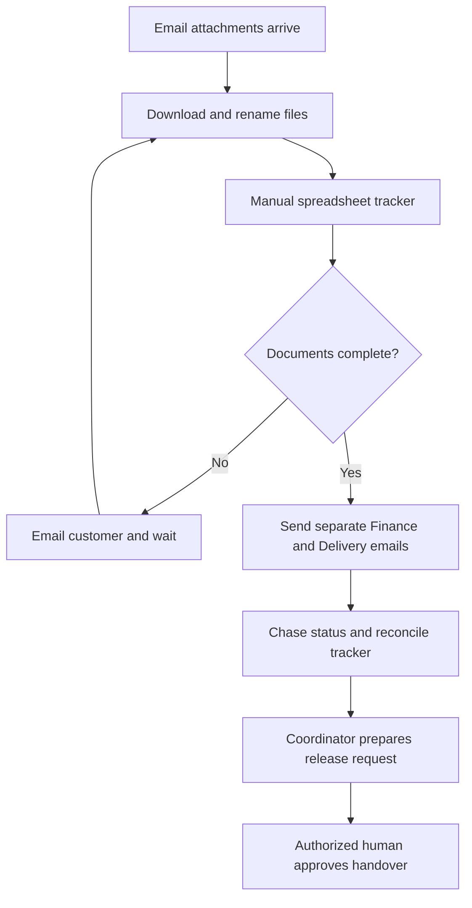
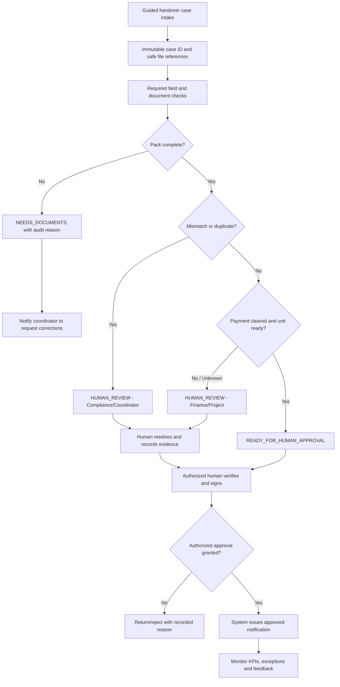

# B — AS-IS / TO-BE Process Design, Controls and SOP

## AS-IS (hypothetical, not observed at Azizi)

## TO-BE (proposed system design, not deployed)

## SOP (future controlled publication)
1. **Create:** Coordinator opens case with unique reference. Collect only approved minimum data.
2. **Validate:** Rules engine checks specified fields. Future document extraction may propose fields, never silently overwrite source data.
3. **Classify:** Missing data gets NEEDS_DOCUMENTS; flags/uncertain statuses get HUMAN_REVIEW; fully complete gets READY_FOR_HUMAN_APPROVAL.
4. **Review:** Assigned human verifies source evidence, confirms finance and project readiness, requests corrections and records reason.
5. **Approve:** Authorized person provides explicit digitally recorded decision. A system-ready state is **not** approval.
6. **Notify:** Approved message only after real approval event; customer-facing wording must be reviewed by Customer Care/Legal.
7. **Monitor:** Review exceptions and overdue work daily; log defects and changes; weekly AI Lead incident and value review.

## Example decision ownership / RACI
| Decision/task | Customer Care | Handover | Finance | Project Delivery | IT/AI Lead | Compliance |
|---|---|---|---|---|---|---|
| Completeness checklist | C | **A/R** | I | I | C | C |
| Payment clearance | I | C | **A/R** | I | I | I |
| Project readiness | I | C | I | **A/R** | I | I |
| Workflow rule changes | I | A | C | C | **R** | C |
| Risk, policy and privacy controls | I | C | C | C | R | **A** |
| Final handover release | I | **A/R** (delegated signatory only) | C | C | I | I |

A = accountable, R = responsible, C = consulted, I = informed. The real organization's formal delegation-of-authority matrix always overrides this fictional RACI.

## Risk and control register
| Risk | Impact | Preventive control | Detective/response |
|---|---|---|---|
| AI extraction misreads identity or unit | Wrong case decision | Confidence gating, human source verification | Sample QA, block on mismatch, error trend |
| Sensitive customer data exposure | Privacy and contractual harm | RBAC, minimization, approved retention | Access logs, incident response |
| Automation sends false approval | Legal/customer impact | No system auto-approval; signed event required | Daily authorization reconciliation and rollback |
| Duplicate submission | Conflicting records | Unique case key and duplicate review | Duplicate queue report |
| Aging escalations create overload | Adoption failure | Workload limits, champions support | Weekly queue age, feedback channel |
| Hidden manual work | Inflated ROI | Time-study sampling and finance sign-off | Quarterly benefit realization review |

**Rollback trigger (planned):** unauthorized status communication, privacy issue, unexplained decision discrepancy or elevated critical defects -> pause automated notifications, revert to controlled manual checklist, open incident, obtain reauthorization before restart.
