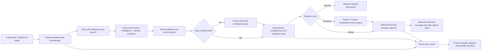

# Technical Solution Blueprint — Document AI, Approvals and Safe Human Control

**Status:** Architecture and test design only. No Microsoft tenant, Azure resource, API, scanned document, OCR model or real user record has been connected or evaluated.

## End-to-end proposed system

## Tool-by-tool boundaries
| Proposed tool | Proposed responsibility | What it cannot be trusted to do automatically |
|---|---|---|
| SharePoint / approved case repository | Store cases and governed source references | Determine whether contractual conditions are satisfied |
| Power Automate + Teams Approvals | Orchestrate queues, reminders and human decisions | Infer undocumented approvals or delegation authority |
| Azure AI Document Intelligence | Extract candidate fields and source location/confidence | Be treated as a fully reliable legal identity checker |
| Power BI | Report event-based adoption, rework and queue aging | Convert modeled capacity savings into financial cash benefits without verification |
| Copilot Studio (separate UC-03 only) | Answer approved FAQ and escalate complex queries | Create binding handover promises or payment decisions |
| Python deterministic demo (included) | Prove specified routing branches over synthetic inputs | Parse scanned PDFs, call LLMs, integrate enterprise applications |

## Document extraction fields (future candidate)
`unit_reference, customer_reference, contract_reference, document_type, payment_clearance_status, issue_date, source_page` plus `extraction_confidence`. Extraction must preserve original evidence and never replace verified system-of-record values without review.

## Risk-based extraction acceptance design (illustrative thresholds; NOT calibrated)
- Proposed **>= 0.95** confidence for *routine low-risk metadata* plus matching system record -> may be **suggested** for review.
- **< 0.95**, inconsistent field or missing provenance -> mandatory manual verification.
- Identity, payment status, readiness, exceptions, contract changes and **final handover approvals require explicit human/source-of-truth checks regardless of model confidence**.
- Confidence alone does not prove accuracy; thresholds must be calibrated on independently labelled, consented/test data before any deployment.

## Evaluation and pilot criteria to establish before AI activation
1. Build a permitted, representative set of redacted or synthetic document types with labelled reference fields, including poor scans, mismatched IDs, duplicates and missing pages.
2. Freeze test split and record model/API versions, prompts/configuration, thresholds and source-document hashes.
3. Evaluate exact field-level match rate, false acceptance of risky fields, false rejections, manual review rate, missing-source link rate and processing time.
4. Inspect errors by document type/language/scan quality; add targeted samples and redesign for accessibility.
5. Run security, privacy, retention, access segregation and incident drills before controlled pilot.
6. Compare against manual baseline, document failures, gain human UAT sign-off and monitor post-deployment drift.

**Hard release gates:** no unauthorized customer notification, no autonomous handover authorization, no financial release from an extracted-only value, audit trail complete, no critical privacy incident, rollback tested. Without real enterprise evidence, the AI deployment status remains **NOT IMPLEMENTED**.
