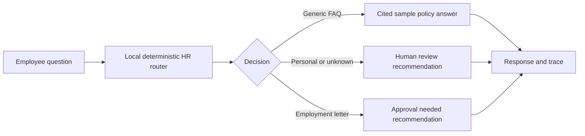

# AI Agent Builder / Automation — HR Service Agent Lab

**Project 50 | HumanEvoX | 30 October 2026**

## What was actually built
A locally runnable **HR service automation prototype** built with JavaScript. It takes employee questions, retrieves fixed, invented policy texts, cites the sample policy versions, and flags private or high-stakes HR requests for human handling. A browser UI shows the response and a decision trace. It does not access HRIS, employee data, email, SharePoint or Microsoft 365.

**Accuracy of the claim:** This is a **rules-based prototype, not an LLM-powered AI agent or deployed Microsoft Copilot Studio application**. The runnable files and evaluations were originally developed in [Project 43](../43_Microsoft_Copilot_Studio_HR_Service_Agent_Prototype/) and are curated here as a practical agent-building/automation case study, **not** as a second independently developed product.

## Architecture

## Try the working prototype
1. Open [index.html](index.html) in a browser and enter a general HR question, such as **What is the annual leave policy?**
2. Try **What's my remaining leave balance?** to inspect human escalation.
3. Try **I need an employment confirmation letter** to see the approval-required decision. No approval is actually sent.
4. With Node.js 18+, execute `node test_agent.js` in this directory. `node test_agent.js --save` writes a fresh trace and `--strict` returns an error on failed scenarios.

## Measured performance — actual local test on 29 October 2026
| Measure | Observed result |
|---|---:|
| Synthetic, developer-authored HR scenarios | 28 |
| Correct decision + source matches | **26/28 (92.9%)** |
| Misses | **2/28** |
| Mandatory human routing in the authored restricted cases | **100%** |
| Live Copilot Studio deployment/evaluation | **Not performed** |
| Real employee outcomes or time savings | **Not measured** |

Two examples failed: **T27** (“Can I have my holiday quota?”) received human escalation rather than an expected policy answer, and **T28** (“Can you arrange proof of employment?”) received human escalation rather than approval-required status. Since T27 concerns an individual quota, its expected label deserves independent HR review before changing the model. See [review findings](evidence/REVIEW_FINDINGS.md).

These are **small synthetic test-set results**, not independent AI quality, safety, fairness, live automation or production-readiness metrics. **Go-live decision: HOLD**.

## Evidence in this folder
- [Working JavaScript agent logic](agent.js)
- [Browser demo](index.html)
- [28 predeclared test scenarios](test_cases.json)
- [Test harness](test_agent.js)
- [Captured test responses and metrics](evidence/2026-10-29_test_run.json)
- [Observed limitations](evidence/REVIEW_FINDINGS.md)

## Microsoft AI agent implementation — proposed, not deployed
The next phase is to build the HR service assistant in an authenticated **Microsoft Copilot Studio** environment, connect only approved *synthetic* policy content, use **Power Automate** to request human approvals, and capture real agent responses for independent QA. [Copilot Studio build guide](../43_Microsoft_Copilot_Studio_HR_Service_Agent_Prototype/COPILOT_STUDIO_BUILD_GUIDE.md) and [Power Automate flow design](../43_Microsoft_Copilot_Studio_HR_Service_Agent_Prototype/POWER_AUTOMATE_FLOW_SPEC.md) are **design documents**, not completed implementations.

## Practical skills demonstrated
HR process definition • low-code agent design planning • simple coded automation • test-case design • reproducible evaluation • source validation • human-in-the-loop controls • performance monitoring and defect review.

**Scope note:** All policies are invented training samples, not UAE labour-law guidance. This is a self-directed portfolio project, not a client implementation.
